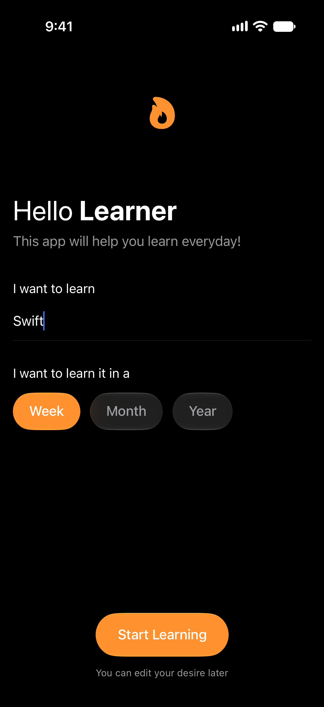

  

<h1 align="center">Learning Journey</h1>

  An iOS app that helps you build a daily learning habit. 
  Set a goal, log every day you learn, and freeze a day when you need a break.

---

## Screenshots

| Onboarding | Activity | Logged today | Calendar |
|:---:|:---:|:---:|:---:|
|  |  |  |  |

## Features

- **Set a learning goal**: write what you want to learn and pick a timeframe (Week, Month or Year).
- **Log as learned**: one big button logs today. It can be used once a day.
- **Freeze a day**: skip a day without losing your streak. The number of freezes is limited per goal.
- **Week strip and stats**: see the current week, the number of learned days and the number of freezed days.
- **Calendar**: browse every month and see which days you learned or freezed.
- **Update your goal**: change the goal at any time. A confirmation alert tells you the streak will start over.
- **Goal end**: when the timeframe ends, the app shows "Well done!" or "Not met", and you can start again with the same goal or set a new one.
- **Saved progress**: your goal and your days are stored on the device.

## Tech

  &nbsp;&nbsp;<b>Sketch</b>&nbsp;design&nbsp;&nbsp;&nbsp;&nbsp;&nbsp;&nbsp;&nbsp;&nbsp;<b>Xcode</b>&nbsp;build&nbsp;&nbsp;&nbsp;&nbsp;&nbsp;&nbsp;&nbsp;&nbsp;<b>Swift</b>&nbsp;language&nbsp;&nbsp;&nbsp;&nbsp;&nbsp;&nbsp;&nbsp;&nbsp;<b>SwiftUI</b>&nbsp;interface

  MVVM architecture · Observation (<code>@Observable</code>) · Liquid Glass

## Getting Started

1. Open `LearningJourney.xcodeproj` in Xcode.
2. Choose an iPhone simulator running an iOS version that supports Liquid Glass.
3. Press **Run** (⌘R).

## Author

May Mohammed || may.mohammed1@outlook.com
