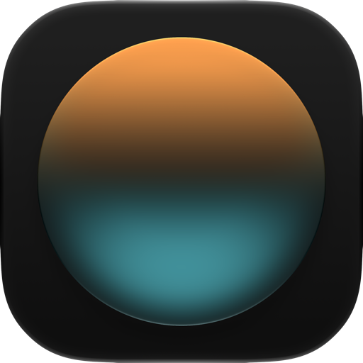
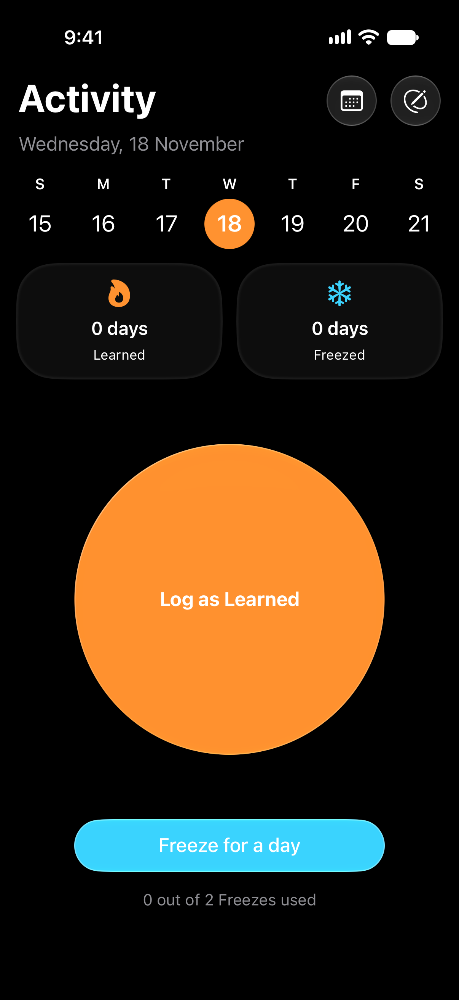
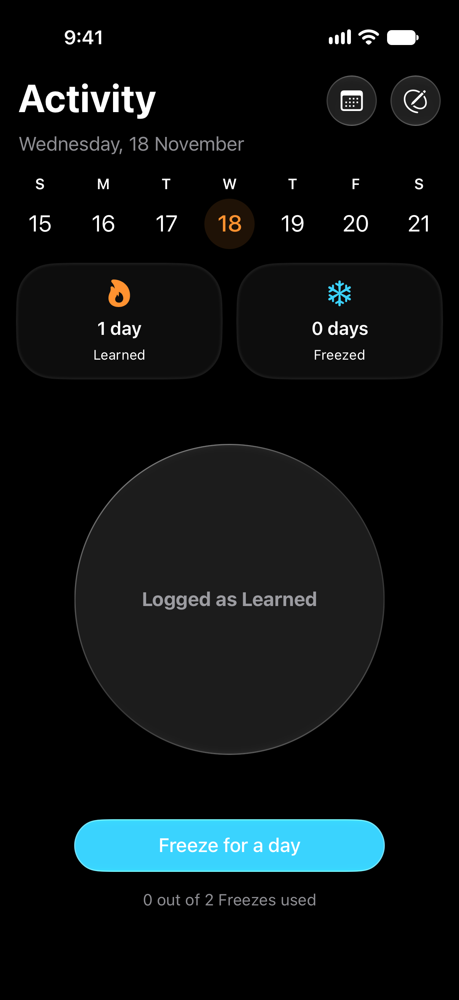
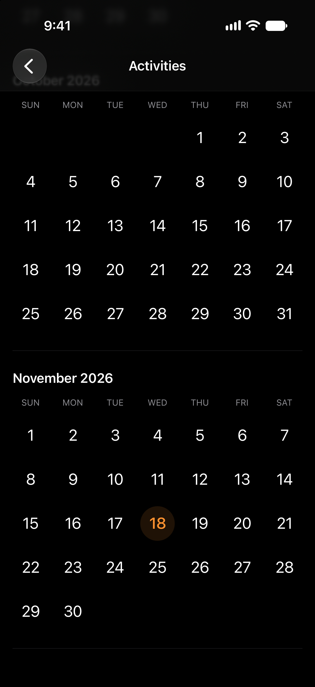

<p align="center">
  
</p>

<h1 align="center">Learning Journey</h1>

<p align="center">
  An iOS app that helps you build a daily learning habit.<br>
  Set a goal, log every day you learn, and freeze a day when you need a break.
</p>

---

## Screenshots

| Onboarding | Activity | Logged today | Calendar |
|:---:|:---:|:---:|:---:|
|  |  |  |  |

## Features

- **Set a learning goal**: write what you want to learn and pick a timeframe (Week, Month or Year).
- **Log as learned**: one big button logs today. It can be used once a day.
- **Freeze a day**: skip a day without losing your streak. The number of freezes is limited per goal.
- **Week strip and stats**: see the current week, the number of learned days and the number of freezed days.
- **Calendar**: browse every month and see which days you learned or freezed.
- **Update your goal**: change the goal at any time. A confirmation alert tells you the streak will start over.
- **Goal end**: when the timeframe ends, the app shows "Well done!" or "Not met", and you can start again with the same goal or set a new one.
- **Saved progress**: your goal and your days are stored on the device.

## Design

The interface follows the Sketch design (dark mode, SF Pro, Liquid Glass):

- Orange `#FF9230` for learned days and the main button.
- Blue `#3CD3FE` for freezed days and the freeze button.
- Liquid Glass buttons, cards and circles using `glassEffect`.

## Tech

| | Tool | What we used it for |
|:---:|:---|:---|
|  | **Sketch** | Designing the screens and the app icon |
|  | **Xcode** | Building, running and testing the app |
|  | **Swift** | The programming language |
|  | **SwiftUI** | Building the interface (with Liquid Glass) |

The app follows the MVVM architecture and uses Observation (`@Observable`).

## Project Structure

```
LearningJourney/
├── Model/        Goal, DayStatus, Timeframe, GoalState, SavedProgress, ProgressStore
├── View/         Screens: Splash, Onboarding, Activity, Calendar, UpdateGoal
│   └── Components/   DayCircle, WeekStripView, StatCard, GoalForm, TimeframePicker, GoalEndView, CustomAlert
├── ViewModel/    Activity, Calendar, Onboarding and UpdateGoal view models
└── Assets.xcassets   Colors and the flame image
```

The views only draw. All the rules (what can be logged, when a goal ends, how many freezes are left) live in the view models.

## Getting Started

1. Open `LearningJourney.xcodeproj` in Xcode.
2. Choose an iPhone simulator running an iOS version that supports Liquid Glass.
3. Press **Run** (⌘R).

## Author

Made by May as a learning project at Apple Developer Academy.
